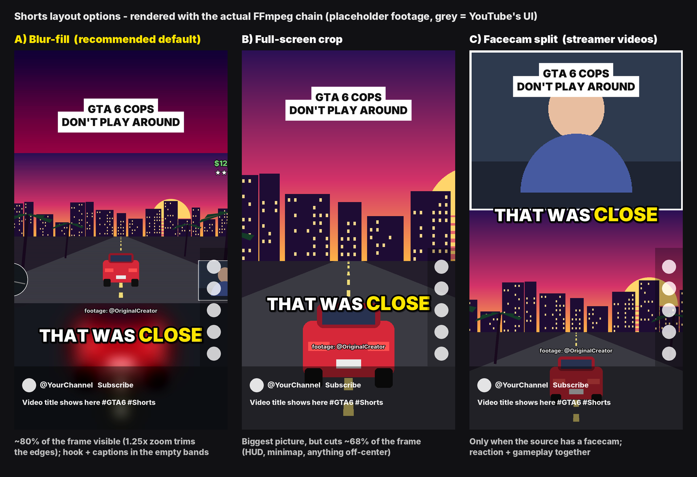

# Gaming Shorts Clipper — Build Plan

*Written 2026-11-09. GTA 6 launches **Nov 19, 2026** on PS5 and Xbox Series X|S (no PC version announced).*

## Status

**Phase 1 is built** (see [README.md](README.md)). Decisions from the review:

- **Computer:** Windows. Setup is a double-click `setup.cmd`, and you run the tool with `clipper`.
- **Sources:** any YouTube video, at the user's risk. The on-screen credit is on by default.
- **Own footage:** no console, so local recordings are a side feature (local files still work).
- **Captions:** English and Hindi, detected automatically. Hindi is shown in Devanagari, with an option to translate it to English.

Changes from the plan, made while building:

- **Minimum clip length is 20 s, not 15,** so viewers get the setup before the payoff.
- **The loudness fallback and local-file input came forward from phase 2/3.** They're small, and the fallback makes the tool usable on launch-day videos that don't have a graph yet.
- **Loudness normalization is my own code, not FFmpeg's `loudnorm`.** FFmpeg missed the target by more than 1 LU on clips with a sudden loud burst. The new step (gain + peak limiter + re-measure) is tested to land within ±0.5 LU.
- **Downloads are checked before use.** yt-dlp can report success with an empty file; broken files are now deleted, never cached.
- **Text sizes come from the font file's own metrics.** The Hindi-capable font draws much smaller than its size number suggests otherwise.

Verified in the sandbox: the yt-dlp partial download keeps sound and picture within a few milliseconds of the source. A full 30 s render from 1080p60 takes about 37 s on 4 CPU cores. Not verifiable there: real YouTube requests (blocked by the sandbox's network) and real speech recognition (model download blocked). Both run for the first time on the user's PC.

---

## 1. Summary

**What it does:** you give it YouTube videos (or it finds them). It reads YouTube's own "Most replayed" graph, cuts the most-rewatched moment, and turns it into a vertical Short with a hook title, word-by-word captions and background music. The finished MP4 and a ready-to-paste title/description land in `output/ready/`. You post from there. The same 9:16 file also works on TikTok and Instagram Reels.

**Cost:** $0. Everything is free and open source and runs on your own PC. No paid APIs, no subscriptions.

**Manual vs automated, my call:** automate the grunt work (finding, cutting, reframing, captions, music, rendering, credits). Keep **you** in the loop for about 2–5 minutes per clip to approve it and write the hook. See section 2.

**The weak part of the idea is rights and monetization, not the tech.** Reposting other creators' best moments is the most crowded and most fragile way to run this. Section 3 explains why and what I'd do instead. The tool will support every option; which sources you use is your choice.

---

## 2. Manual vs automated

| Step | Who | Why |
|---|---|---|
| Find candidate videos | Tool (search + channel watchlist) and you (paste URLs) | The tool filters by views, age and length, and skips anything already used |
| Find the best moment | Tool | It uses YouTube's real audience replay data instead of guessing |
| Cut, reframe to 9:16, captions, music, render | Tool | Repetitive and identical every time, which is what code is good at |
| Hook text + title | **You** (tool suggests options) | The biggest lever on views. Mass-produced, templated uploads are what YouTube's "inauthentic content" policy targets |
| Policy check | **You** | No free tool reliably judges graphic violence in the first ~7 s (no ads), mass violence against civilians (age restriction), or story spoilers |
| Upload | **You** | YouTube API uploads from unaudited apps are locked to private. Uploading by hand also lets you add a trending sound in the YouTube app |

**Why not just use CapCut or OpusClip?**
- **CapCut:** editing every clip by hand doesn't scale, and free auto-captions are capped or paywalled depending on region and version (reports conflict).
- **OpusClip:** the free plan gives 60 minutes of source video per month, adds a watermark, and clips expire after 3 days. Paid plans cost $15–$29/month. It picks moments with its own AI, not with YouTube's replay data from someone else's video.
- **This tool:** $0, no watermark, no limits, and it uses the signal you asked for: the most-replayed part of the timeline.

---

## 3. Reality check: read before we build

### 3.1 Rights
- A gameplay video belongs to the creator who recorded it, and the game belongs to Take-Two. If you repost it, the creator can file a Content ID claim (you lose the revenue or the video is blocked) or a copyright strike. **3 strikes in 90 days and the channel is deleted.**
- **YouTube blocks Shorts longer than 1 minute worldwide while they have any active Content ID claim.** So the tool caps clips at **59 s** by default.
- Rockstar's posting policy, as quoted in the press, says isolated cutscene videos get removed, and it targets spoilers and leaked footage. (I couldn't open the policy page itself from my sandbox.) So: never clip a cutscene on its own, and don't touch pre-release leaks between now and Nov 19.
- I won't build Content ID evasion tricks (mirroring, pitch-shifting, speed hacks). They break YouTube's rules, put the whole channel at risk, and don't fix the underlying problem.

### 3.2 Monetization
- **Reused content policy:** clips and compilations can only be monetized if viewers can see a *meaningful difference* from the original. Captions and music over someone else's clip may not pass a monetization review. YouTube's July 2025 "inauthentic content" rename left this policy unchanged.
- **Monetization bar today:** 1,000 subscribers plus either 4,000 watch hours in 12 months or 10M Shorts views in 90 days.
- **From Feb 1, 2027** (announced Aug 10, 2026), new applicants need 8,000 watch hours or **20M** Shorts views. Some outlets also report a recurring test of 10M Shorts views every 90 days to keep earning from Shorts; reports are inconsistent on this. Qualifying under today's bar means 1,000 subs + 10M Shorts views before Feb 1, during the launch window. That's ambitious for a new channel, so plan as if the 20M bar applies.
- **September 2026 ad rule (reported):** graphic violence in roughly the first 7 s means no ads; around 8–15 s means limited ads.
- **Since Nov 17, 2025:** gaming videos with realistic human characters that focus on torture or mass violence against non-combatants get age-restricted. Signed-out and under-18 viewers can't see them, which kills Shorts reach. GTA "rampage" clips are exactly this.

### 3.3 Competition
Expect many clip channels to run this same playbook on the same big creators' videos at launch. A top creator's most-replayed moment will likely be clipped by several channels within hours. Speed and a distinct angle will matter more than the tool.

### 3.4 What I recommend instead
Same tool, better sources, more transformation.

1. **Source priority**
   1. **Your own gameplay**, if you have (or get) a PS5/Xbox and the game. No rights risk, fully monetizable. The tool will accept local recordings and find highlights from loudness and scene-change spikes.
   2. **Creators who say yes.** DM small and mid-size GTA creators: "I'll clip your videos with credit and a link." It's free promotion for them. They go in `allowed_channels` in the config.
   3. **Paid clipping campaigns** such as Whop Content Rewards, where creators pay clippers per view and permission is built in. One analysis of 50 live campaigns (Sep 28, 2026) found a median of $1.00 per 1,000 views (range $0.05–$3.00). This income doesn't depend on YouTube monetization.
   4. **Any YouTube video.** The tool allows it, but you carry the risk. Don't run it on a channel you can't afford to lose.
2. **Transformation YouTube can see:** hook and context text, captions, an optional voiceover (your voice or free text-to-speech), and weekly "Top 5 most replayed GTA 6 moments" compilations with rankings and commentary. Compilations are 16:9 long-form videos, which also count toward watch hours.
3. **Use the heatmap as research.** The moment types people replay (chases, physics fails, NPC reactions) tell you what to record or clip next.

---

## 4. How the tool works

```
 URLs / search / channel watchlist / local files
   │
   ├─ 1. Discover      yt-dlp search + filters (views, age, length) + "already used?" check (SQLite)
   ├─ 2. Metadata      yt-dlp: heatmap (100 points), chapters, SponsorBlock segments, comments
   ├─ 3. Find moments  peak detection on the heatmap (fallbacks below)
   ├─ 4. Download      only the chosen segment + padding, never the whole video
   ├─ 5. Refine cut    snap to scene cuts and sentence boundaries; locate the payoff
   ├─ 6. Transcribe    faster-whisper with word-level timestamps
   ├─ 7. Compose 9:16  layout + hook + captions + credit (+ optional zoom punch-in)
   ├─ 8. Audio         game audio + music dipped under speech, normalized to -14 LUFS
   ├─ 9. Render        FFmpeg -> H.264 MP4
   └─ 10. Package      clip.mp4, clip_nomusic.mp4, post.txt, thumb.jpg, meta.json
                         -> output/review/  -> you approve ->  output/ready/  (post from here)
```

### 4.1 Finding the most-replayed moment

**The data:** I checked the current yt-dlp source (version 2026.10.26). It exposes YouTube's "Most replayed" graph as a `heatmap` field: 100 points, each with `start_time`, `end_time` and a `value` from 0 to 1. No API key needed.

**Its limits:**
- Resolution is the video length ÷ 100. A 20-minute video gives 12-second buckets; a 2-hour stream gives 72-second buckets. The heatmap tells us *roughly where*, and step 5 finds the exact cut.
- YouTube only shows the graph on videos with enough views and doesn't publish the threshold. Brand-new launch-day uploads often won't have it yet.

**Algorithm:**
1. **Mask noise:** remove sponsor, self-promo, intro and outro segments (from SponsorBlock) and the first and last few percent of the video. Also mask the bucket right after each sponsor, because viewers skipping the ad can create a fake spike there.
2. **Find peaks:** smooth lightly, then run `scipy.signal.find_peaks` (minimum prominence about 0.15, peaks at least about 60 s apart).
3. **Score** each peak as height × prominence. When ranking across videos, also weight by view count and upload recency.
4. **Window:** take the buckets around the peak that are at least 70% of its height, start 3–5 s earlier to include the setup, and clamp the length to 15–59 s.
5. **Refine** on the downloaded segment: start on a scene cut or the start of a sentence, end just after the payoff (sentence end or loudness drop), and make sure the payoff lands in the first half of the clip.

**Fallbacks when there's no heatmap**, in order:
1. **Comment timestamps** ("4:32 💀💀"), weighted by likes. Viewers mark the best moments within hours of upload, before the heatmap exists. The top comment for that timestamp also becomes a hook suggestion.
2. **Chapters.**
3. **Loudness spikes + scene-change density.** This is also how the tool handles your own recordings.

### 4.2 The edit (default template)

The mockup below was rendered with the real FFmpeg filter chain, using placeholder footage. Grey areas show where YouTube's own buttons and title sit.



- **Format:** 1080×1920, source frame rate up to 60 fps, H.264.
- **Length:** 15–59 s. Start at most 3 s before the action and end at most 1.5 s after the payoff, with no outro, so the clip loops.
- **Layout:** A (blur-fill) by default. B (full-screen crop) for close-up action. C (facecam split) when the source has a webcam; the webcam position is set per creator at first and auto-detected later.
- **Hook text:** top band, at most 2 lines / about 6 words, black text on a white box.
- **Captions:** 1–3 words at a time, uppercase, heavy free font, current word in yellow with a small pop. Kept out of the areas YouTube's UI covers (roughly the bottom 320 px and the right 140 px). Optional profanity masking.
- **Credit:** "footage: @creator" on screen, source link in the description.
- **Audio:** game audio normalized; music about 18–22 dB quieter and automatically dipped when someone talks; fade in and out; final loudness -14 LUFS, true peak -1 dB.
- **Optional extras:** zoom punch-in on the loudest moment, whoosh/boom sound effect, progress bar.
- **Second export without music,** so you can add a trending sound in the YouTube app when you upload.
- **No emoji burned into the video,** because the subtitle renderer can't draw color emoji. Emoji go in the title instead.

### 4.3 What lands in the folder

```
output/
  review/2026-11-20/001_cops-dont-play/
      clip.mp4           the Short
      clip_nomusic.mp4   same clip, game audio only
      post.txt           3 title options, description with credits, hashtags
      thumb.jpg          frame for quick review
      meta.json          source URL, timestamps, scores, music track + license
  ready/                 approved clips: the folder you post from
```

---

## 5. Tools (all free)

| Tool | Job | Note |
|---|---|---|
| Python 3.11+ | Glue code | Windows, macOS or Linux |
| yt-dlp + Deno | Search, metadata, heatmap, comments, segment download | YouTube now requires a JavaScript runtime. `pip install "yt-dlp[default,deno]"` installs both (checked in 2026.10.26). YouTube changes often break yt-dlp, so setup always updates it |
| FFmpeg | All video and audio work | Checked in FFmpeg 6.1: subtitle rendering, blur, audio ducking, loudness normalization and scene detection are all built in |
| faster-whisper | Captions with word timings | A CPU is fine for clips under 60 s; an NVIDIA GPU is faster |
| PySceneDetect | Scene cuts | Clean start and end points |
| numpy / scipy | Peak detection | |
| SponsorBlock (via yt-dlp) | Remove sponsor and intro noise | Free community data |
| SQLite | Remembers what's been used | Built into Python |
| Typer + Rich | Command line | |
| Gradio | Local review dashboard (phase 2) | Runs in your browser on your own machine |
| Google Fonts (OFL license) | Caption and hook fonts | Free for commercial use |
| NCS, YouTube Audio Library | Music | Free to use on YouTube. NCS asks for credit in the description; the tool writes credits automatically |
| Ollama (optional) | Title ideas from a local AI model | Off by default; $0 |
| Twitch Clips API (optional, phase 3) | Top clips per game | Free developer keys. Reportedly sorted by views (to be checked). Useful in launch week, before YouTube heatmaps exist |

**Deliberately not used:**
- **Paid AI APIs:** not needed.
- **Cloud servers:** YouTube challenges datacenter IPs with "confirm you're not a bot" checks. Your home connection is free and the most reliable option. The tool will space out its requests and cap videos per run. If YouTube still asks for a sign-in, use cookies from a throwaway Google account, never your main one.
- **YouTube upload API:** uploads from unaudited apps are locked to private.

---

## 6. Cost

| Item | Cost |
|---|---|
| Software | $0 |
| Music and fonts | $0 (free licenses, credit where required) |
| Running it | Your PC + electricity |
| **Total** | **$0** |

Your time: about 1 hour of one-time setup, then about 2–5 minutes of review per clip.
Hardware: any recent PC with 8 GB RAM and about 20 GB of free disk. A GPU is optional.

---

## 7. Build phases

**Phase 1: MVP (target: before Nov 19)**
`clipper make <youtube-url>` runs end to end: heatmap → best moment → segment download → layout A → captions → hook text (typed on the command line) → music with ducking → MP4 + post.txt in the output folder. Includes unit tests for the moment-finder (with synthetic heatmaps) and for rendering (with synthetic video).

*Done when:* a URL with a heatmap produces a 15–59 s vertical MP4 that contains the top-replayed moment, has readable captions and music dipped under speech, measures within ±1 LU of -14 LUFS, and comes with a post.txt that includes credits.

**Phase 2: batch + review (launch week)**
Search and watchlist discovery, "already used" tracking, comment-timestamp fallback, SponsorBlock masking, a review dashboard (watch / approve / reject / edit hook → re-render), and the no-music export.

**Phase 3: growth**
Facecam split with auto-detection, zoom punch-ins and sound effects, weekly 16:9 compilations, local-recording mode, Twitch clips, optional local AI titles, and TikTok/Reels hashtag presets.

**One limitation:** my cloud sandbox can't reach YouTube (its network policy blocks it). I can test the logic and rendering here, but the first real YouTube run has to happen on your PC. I'll make that a single command. GTA V and RDR2 videos are good test material before GTA 6 launches, since they already have heatmaps.

---

## 8. Code layout

```
clipper/
  cli.py          commands: make, discover, review, render
  config.py       loads config.yaml
  discover.py     search / watchlist / filters
  metadata.py     yt-dlp info: heatmap, chapters, comments, SponsorBlock
  moments.py      peak detection + fallbacks
  download.py     segment download
  refine.py       scene cuts, sentence boundaries, loudness
  transcribe.py   faster-whisper
  captions.py     animated subtitle file (ASS)
  layout.py       FFmpeg filter graphs for layouts A/B/C
  audio.py        music pick, ducking, loudness
  render.py       runs FFmpeg
  package.py      output folder, post.txt, thumbnail
  db.py           SQLite
assets/   music/<mood>/   fonts/   sfx/
config.yaml   tests/   output/ (not committed)
```

---

## 9. Decisions (answered 2026-11-09)

1. **Computer:** Windows (no GPU mentioned, so captions run on the CPU by default).
2. **Sources:** (a), any YouTube video, at the user's risk.
3. **Own footage:** no console.
4. **Caption language:** English and Hindi.

---

## Sources

- GTA 6 date and platforms: [GTA Boss](https://www.gtaboss.gg/gta-6/guides/gta-6-release-date), [Rockstar Report](https://rockstarreport.com/features/gta-6-release-date-tracker)
- yt-dlp heatmap field and Deno requirement: checked directly in the yt-dlp 2026.10.26 package source (`yt_dlp/extractor/youtube/_video.py`, `_extract_heatmap`); project: [yt-dlp on GitHub](https://github.com/yt-dlp/yt-dlp)
- Shorts over 1 minute with Content ID claims are blocked: [YouTube Help: three-minute Shorts](https://support.google.com/youtube/answer/15424877?hl=en)
- Reused vs inauthentic content: [Search Engine Journal](https://www.searchenginejournal.com/youtube-clarifies-monetization-update-targeting-spam-not-reaction-channels/550123/), [Plagiarism Today](https://www.plagiarismtoday.com/2025/07/08/youtube-targets-inauthentic-content/)
- Monetization thresholds and the Feb 2027 change: [The Next Web](https://thenextweb.com/news/youtube-partner-program-doubles-entry-requirements-2027), [Shacknews](https://www.shacknews.com/article/150324/youtube-partner-program-minimum-qualified-public-watch-hours-shorts-views), [vidIQ](https://vidiq.com/blog/post/youtube-partner-program-changes-2027/), [PPC Land](https://ppc.land/youtube-doubles-monetization-thresholds-and-adds-a-rolling-shorts-test/)
- September 2026 gaming-violence ad rule: [Express Tribune](https://tribune.com.pk/story/2627692/youtube-updates-gaming-violence-monetisation-rules-ahead-of-gta-6-launch), [Northeast Times](https://northeasttimes.com/2026/09/04/youtube-sets-new-timing-rules-for-ad-revenue-on-graphic-gaming-content/), [Dexerto](https://www.dexerto.com/gta/youtube-updates-gaming-violence-monetization-rules-ahead-of-gta-6-launch-3405945/)
- November 2025 age restrictions for violent games: [PC Gamer](https://www.pcgamer.com/software/platforms/youtube-updates-its-policy-on-violent-videogame-clips-with-guidelines-that-seem-aimed-at-the-incoming-flood-of-gta-6-videos), [Tubefilter](https://www.tubefilter.com/2025/10/30/youtube-gambling-video-game-violence-nfts-age-restrict/amp/)
- YouTube API uploads locked to private for unaudited apps: [YouTube Data API: videos.insert](https://developers.google.com/youtube/v3/docs/videos/insert)
- Rockstar posting policy: [Rockstar Support](https://support.rockstargames.com/articles/7bNaeoMFTV0iUDGhStTXvz/policy-on-posting-copyrighted-material) (not reachable from my sandbox), as quoted by [ShiftDelete](https://shiftdelete.net/en/gta-6-spoilers)
- NCS music terms: [NCS usage policy](https://ncs.io/UsagePolicy)
- Clipping campaign rates: [Foundry analysis of 50 campaigns](https://www.builtbyfoundry.io/blog/what-is-clipping-1-dollar-per-1000-views-50-campaigns), [Whop docs](https://docs.whop.com/manage-your-business/growth-marketing/content-rewards)
- OpusClip pricing: [Castmagic](https://www.castmagic.io/blog/opus-clip-pricing), [Costbench](https://costbench.com/software/ai-video-editing-saas/opus-clip/free-plan/)
- CapCut captions: [Descript](https://descript.com/blog/article/capcut-captions-arent-free-anymore-heres-a-better-option), [BIGVU](https://bigvu.tv/blog/capcut-free-vs-pro-what-2026s-restructure-gives-you/)
- Twitch clips: [Twitch API docs](https://dev.twitch.tv/docs/api/clips/), [Twitch4J reference](https://twitch4j.github.io/rest-helix/clips-get)
