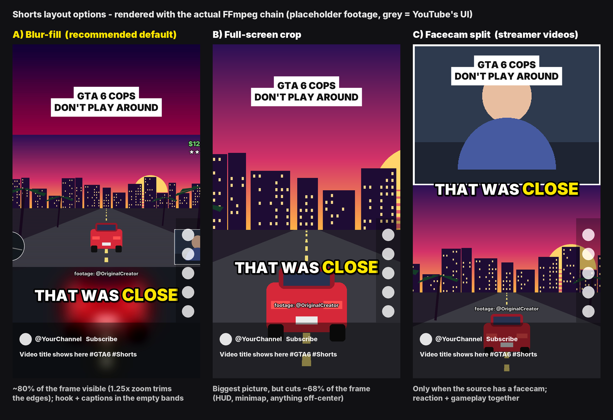

# Gaming Shorts Clipper: user manual

Put YouTube gameplay links in an Excel sheet. The tool finds the parts people rewatch most and cuts them into
vertical Shorts. Each Short gets a hook, word-by-word captions (English, or Hindi in English letters), effects and
background music. You can fix the captions before the video is made, and the tool writes titles and a description
for posting. It's free and runs on your own PC.



## Contents

1. [What you need](#1-what-you-need)
2. [Install (once)](#2-install-once)
3. [Your first Short in 5 minutes](#3-your-first-short-in-5-minutes)
4. [Three ways to use it](#4-three-ways-to-use-it)
5. [The Excel sheet (clips.xlsx)](#5-the-excel-sheet-clipsxlsx)
6. [Checking and editing captions](#6-checking-and-editing-captions)
7. [Swear words](#7-swear-words)
8. [Layouts: blur, crop and facecam split](#8-layouts-blur-crop-and-facecam-split)
9. [Effects](#9-effects)
10. [Picture quality](#10-picture-quality)
11. [What you get](#11-what-you-get)
12. [Before you post](#12-before-you-post)
13. [How the moments are picked](#13-how-the-moments-are-picked)
14. [Gemini (optional, free)](#14-gemini-optional-free)
15. [Graphics card (GPU)](#15-graphics-card-gpu)
16. [Commands](#16-commands)
17. [Settings (config.yaml)](#17-settings-configyaml)
18. [Updating](#18-updating)
19. [Troubleshooting](#19-troubleshooting)
20. [Questions](#20-questions)
21. [Sharing with friends](#21-sharing-with-friends)
22. [Uninstalling](#22-uninstalling)
23. [Speed and cost](#23-speed-and-cost)
24. [For developers](#24-for-developers)

## 1. What you need

- A Windows 10 or 11 PC with an internet connection. macOS and Linux work too (see [Questions](#20-questions)).
- About 10 GB of free disk space: the tool, the speech model (0.5 to 3 GB) and the downloaded clips.
- Optional: an **NVIDIA graphics card** makes captions faster and more accurate. Any NVIDIA, AMD or Intel graphics
  makes the final video encode faster.
- Optional: a free **Gemini key** for better captions, hooks and titles. See [Gemini](#14-gemini-optional-free).

Everything the tool uses is free. Nothing asks for a card or a subscription.

## 2. Install (once)

**Step 1: install Python and FFmpeg.** Open **Terminal** (or PowerShell) from the Start menu. Then run these two
commands one after the other; they install from Microsoft's own app installer:

```bash
winget install Python.Python.3.12
```

```bash
winget install Gyan.FFmpeg
```

Close the terminal window afterwards, so the next one finds the new programs.

**Step 2: get the tool.** Choose one way:

- **Easiest:** on the project's GitHub page click **Code → Download ZIP**, then unzip it, for example into
  `Documents\clipper`.
- **Better for updates:** if you have git, clone it. Then `clipper update` (or menu option 6) updates the tool in
  one step:

  ```bash
  git clone https://github.com/PiRaNg-1256/solid-wiener.git clipper
  ```

**Step 3: run the setup.** Open the folder and double-click **`setup.cmd`**. It takes a few minutes the first time.
It:
- makes a private Python environment in the `.venv` folder (nothing is installed system-wide);
- installs the tool and what it needs, plus NVIDIA's GPU library if you have an NVIDIA card (about 550 MB);
- creates `config.yaml` (your settings) and `clips.xlsx` (your list of videos), if they don't exist yet;
- offers to install FFmpeg if it's still missing;
- ends with a **checklist** (`clipper doctor`). Everything except "Music" should show a ✓.

**Step 4: add music.** Put a few `.mp3` files into `assets\music`. Only use music you're allowed to use; the
[music README](assets/music/README.md) lists free sources and explains credit lines. Without music the clips
simply have the game audio.

**Step 5 (optional): add a free Gemini key.** See [Gemini](#14-gemini-optional-free).

**Step 6 (optional): put your channel name on your clips.** Open `config.yaml` in Notepad, find
`watermark: ""` and type your handle between the quotes, for example `watermark: "@MyChannel"`.

## 3. Your first Short in 5 minutes

1. Double-click **`menu.cmd`**.
2. Type **2** and press Enter, paste a YouTube link, and press Enter twice.
3. The tool downloads only the part it needs and makes captions. It asks you for a hook: press Enter to take its
   suggestion, or type your own.
4. When it says ✓, type **4** to open the output folder. Your Short is `clip.mp4`, and the title and description
   to paste are in `post.txt`.

For more than one video, use the [Excel sheet](#5-the-excel-sheet-clipsxlsx): it's the everyday way.

## 4. Three ways to use it

| Way | How | Best for |
|---|---|---|
| **The menu** | Double-click `menu.cmd` and pick a number. | Trying it out, one video, checking the setup, updating. |
| **The Excel sheet** | Put links in `clips.xlsx`, then double-click `run.cmd`. | Everyday use: many videos, your own clip times, checking captions before the video is made. |
| **Commands** | Type `.\clipper make "<link>"` in a terminal. | People who like terminals. Every option is listed in [Commands](#16-commands). |

To open a terminal in the right place: open the tool's folder in Explorer, click the address bar, type
`powershell` and press Enter. In PowerShell type `.\clipper`; in Command Prompt type `clipper`.

## 5. The Excel sheet (clips.xlsx)

### Everyday steps

1. Open **`clips.xlsx`** (in the tool's folder). On the **Videos** tab, put one YouTube link per row in
   **Video link**. Leave **Status** empty. Fill in only what you want to change: every empty cell uses the default.
2. Save and **close** the file. The tool can't write to it while Excel has it open.
3. Double-click **`run.cmd`** (or menu option 1).
4. Rows now say **Edit captions**. Open the folder shown in **Clip folders**. In each clip folder:
   - look at `preview.jpg`: one frame of the Short as it will look;
   - fix any wrong words in `captions.srt` (Notepad is fine, see [Checking and editing captions](#6-checking-and-editing-captions));
   - change the hook in `hook.txt` if you like.
5. In clips.xlsx set those rows' **Status** to **Ready**, save, close, and double-click `run.cmd` again.
6. The videos are made. Status becomes **Done**, and **Videos** shows where each `clip.mp4` is. The title and
   description to paste when posting are in `post.txt` next to it.

Don't want to check captions for a row? Put **No** in **Check captions first** and the video is made in one go.
The tool never works on a row twice: rows that say Done, Edit captions, Failed or Skip are left alone.

### Status values

| Status | Meaning |
|---|---|
| *(empty)* | New row: the tool works on it at the next run. |
| **Edit captions** | Captions are made. Check them, then set Ready. |
| **Ready** | You set this: the next run makes the video(s). |
| **Done** | Finished. The **Videos** column says where the clips are. |
| **Failed: …** | Something went wrong; the reason follows. Fix it, clear the Status (or set Redo), run again. |
| **Redo** | You set this: the row is made again from the start. |
| **Skip** | You set this: the row is ignored. |

### The columns

| Column | What to type | Empty means |
|---|---|---|
| **Status** | See the table above. | New row: work on it. |
| **Video link** | The YouTube link (or the full path of a video file on your PC). | Row is ignored. |
| **Clip times** | Your own clips: `start-end`, several separated by commas: `1:20-1:45, 5:10-5:40`. Only a start (`2:05`) = 30 seconds from there. | The tool finds the best moments. |
| **How many clips** | How many of the best moments to clip (only when Clip times is empty), 1 to 10. | 1 |
| **Hook text** | Your hook. For several clips, separate them with `;` in the same order as the clip times. `-` = no hook, `\|` = new line. | Gemini writes one (without Gemini: from the video title). |
| **Check captions first** | Yes / No | Yes |
| **Caption language** | Auto / English / Hindi (Hindi is written in English letters). | Auto |
| **Translate Hindi to English** | Yes = English captions for Hindi speech. | No |
| **Layout** | Blur (whole gameplay on a blurred background) / Crop (fill the screen). | Blur |
| **Zoom** | 1 to 2. Blur layout only: higher = bigger gameplay, edges trimmed. | 1.25 |
| **Facecam** | For streams with a webcam: **Auto**, or the corner it's in (**Bottom right**, Bottom left, Top right, Top left), or an exact box. **Off** = normal layout. See [Facecam split](#facecam-split-streams-with-a-webcam). | Normal layout |
| **Effects** | **Default** (zoom cut, word pop, hook pop, shadow) / **None** (a clean clip) / **All** (adds the progress bar and sound effects). See [Effects](#9-effects). | Default |
| **Swear words** | **Mask** (shown as f\*\*k) / **Mask + beep** (also beeped in the audio) / **Show** (as said; slurs are always masked). See [Swear words](#7-swear-words). | Mask |
| **Music** | Random / None / the name of a file in `assets\music`. | Random |
| **Show credit** | Yes / No ("footage: @creator" on the video). | Yes |
| **Use Gemini** | Yes / No. | Yes, when a key is set |
| **Game** | gta6 / gta5 / rdr2, or a game you added in config.yaml. Picks hashtags and helps captions spell names. | Detected from the video title |

The grey columns on the right are filled in by the tool: video title, clip folders, finished videos, hooks used,
titles, notes (where the moments came from, problems) and the time of the last run.
Hover over any header in Excel to see its explanation, and see the **How to use** tab.

A clips.xlsx made by an older version gets new columns (Facecam, Effects, Swear words) added at the far right on the
next run. They work the same there.

### Examples

| What you want | What to type |
|---|---|
| 1 clip of the most-replayed moment | Only the link. |
| The best 3 moments | **How many clips:** `3` |
| **5 clips, each at your own times** | **Clip times:** `1:20-1:45, 5:10-5:40, 8:00-8:30, 12:00-12:25, 15:30-16:00` |
| Your own hook for each of those | **Hook text:** `COPS GOT ME; THIS JUMP; NO WAY; BRO WHAT; LAST ONE` |
| Hooks for only some clips | **Hook text:** `COPS GOT ME;; NO WAY` (clips 2, 4, 5 get Gemini's hook) |
| A hook on two lines | **Hook text:** `GTA 6 COPS \| DON'T PLAY` |
| No hook | **Hook text:** `-` |
| A clip starting at 2:05 | **Clip times:** `2:05` (30 seconds) |
| Times after the first hour | **Clip times:** `1:02:10-1:02:40` |
| Webcam big on top, gameplay below | **Facecam:** `Auto` (or the corner, like `Bottom right`) |
| A clean clip without effects | **Effects:** `None` |
| Swears beeped as well as masked | **Swear words:** `Mask + beep` |
| Different settings for different clips of one video | One row per clip, with the same link. |
| Make a finished row again | **Status:** `Redo` |

Times are minutes:seconds (`1:20`) or hours:minutes:seconds (`1:02:10`). The tool may move a cut by up to a
second so it doesn't cut a word in half. Automatic clips last 20 to 59 seconds: Shorts over 60 seconds get blocked
if anyone claims copyright.

## 6. Checking and editing captions

`captions.srt` looks like this. Each block is one caption on screen; its words light up one by one.

```
1
00:00:01,200 --> 00:00:02,050
bhai dekh police

2
00:00:02,300 --> 00:00:03,100
aa gayi
```

- Change the words freely. If a caption keeps the same number of words, each word keeps its exact timing.
  Otherwise the caption's time is shared between its words.
- You can change the times, delete a block, or add one (with its own time line). The numbers don't matter.
- Write normally: the video shows captions in capitals with the spoken word in yellow.
- Swear words stay as they are in this file; the video masks them (see [Swear words](#7-swear-words)). `****`
  means the speech model heard a swear but not which one: type the real word if you know it.
- `hook.txt` is the text at the top of the Short; each line is a line on screen.
- Free tool with a preview, if you want one: Subtitle Edit (opens .srt files).

How captions are made: a speech model on your PC (Whisper) writes the words and their timings. It knows the game's
names and places (from `games` in config.yaml) and the names you add to `captions.vocabulary`. With a Gemini key,
Gemini double-checks the words. Lines the speech model invents over music (like "Thanks for watching!") are dropped
automatically.

## 7. Swear words

Gamers swear, and captions should show what was said, not a different word. So:

- **The speech model and Gemini are told to write swears as said**, in English and Hindi. Speech models learn from
  subtitles that often censor swearing, which is why they used to drop swears or write milder words. If Gemini
  still writes `f***` or "freaking", the tool takes the word the local speech model heard at that moment.
- **On screen, swears are masked**, keeping the first and last letter: `f**k`, `b******d`, `c*****a`. Hindi script
  works the same way.
- **captions.srt keeps the real words**, so you can change the setting and make the video again.
- **Titles, descriptions and hashtags never get swears.** YouTube gives no ads to videos with strong language in
  the title or thumbnail. Since the hook is on every frame (so also on the cover picture), automatic hooks skip
  swears too. A hook you type yourself is masked like the captions.

Choose per row with the **Swear words** column, or for everything with `captions.profanity` in config.yaml:

| Setting | On screen | Audio |
|---|---|---|
| **Mask** (default, `captions.profanity: mask`) | Strong swears masked: f\*\*k, s\*\*t, b\*\*\*h, bhenchod, chutiya… Mild words (damn, hell, saala) shown. | As said |
| **Mask + beep** (`captions.bleep: "all"`) | As Mask | Masked swears beeped |
| `captions.profanity: strict` | Mild words masked too | As said |
| **Show** (`captions.profanity: show`) | As said | As said |

Slurs are always masked, whatever the setting. As of July 2025 YouTube no longer cuts ads for strong swearing in
the first 7 seconds. Frequent strong swearing throughout a video, and any in the title or thumbnail, still limit
ads.

## 8. Layouts: blur, crop and facecam split

- **Blur** (default): the whole gameplay in the middle, a blurred copy behind it, the hook above and captions
  below. **Zoom** (1 to 2) makes the gameplay bigger by trimming its sides.
- **Crop**: fills the whole screen with the middle third of the video. Good when the action is in the centre.

### Facecam split (streams with a webcam)

Put **Auto** (or the webcam's corner) in the **Facecam** column. The Short is split in two:

- **Top half: the webcam, enlarged.** It's cropped around the face to fit the panel, then scaled up.
- **Bottom half: the gameplay.** It's taken from the side away from the webcam, so the webcam's original corner
  is left out and the face never shows twice. If the webcam sits so central that it can't be avoided, that spot
  is blurred over instead.
- Nothing covers the face: the hook sits on the line between the two halves, and the captions go just under it
  (with no hook, the captions sit on the line).

How the webcam is found: **Auto** samples a dozen frames and looks for a face that stays in the same place (game
characters move around; a webcam doesn't), then finds the webcam's rectangle from its border. That border is the
edge that stays put while the gameplay changes. A **corner** name works even when no face is visible (for example,
a streamer who is turned away). With Auto and no webcam, the clip falls back to the normal layout, and Notes says so.

**Check `preview.jpg`** in the clip folder (it's made with the captions). If the webcam box is off:
- type the corner instead of Auto, or
- give the exact box as `x,y,w,h` in percent of the video frame: `75,70,25,30` means "starts 75% from the left and
  70% from the top; 25% wide and 30% tall";

then set Status to Ready. The box is worked out again before the video is made.

A small webcam stretched to half the screen looks soft. That's why facecam clips download 1440p when YouTube has
it. `style.facecam_share` in config.yaml sets how much of the height the webcam gets (0.3 to 0.6, default 0.5).

## 9. Effects

| Effect | What it does | On by default | Setting |
|---|---|---|---|
| Zoom cut | The gameplay jumps 8% closer on the most intense moment (and one more loud moment), then back. Never the webcam or the text. | Yes | `effects.zoom_punch`, `effects.zoom_amount`, `effects.max_punches` |
| Word pop | The word being said pops slightly bigger, in the highlight colour. | Yes | `effects.word_pop` |
| Hook pop | The hook pops in at the start. | Yes | `effects.hook_pop` |
| Shadow | Blur layout: a soft shadow under the gameplay and darker corners. | Yes | `effects.shadow` |
| Progress bar | A thin bar at the top fills up as the Short plays. | No | `effects.progress_bar` |
| Sounds | A soft whoosh when the hook appears and a low hit on each zoom cut. Made by the tool itself, so no licence issues. | No | `effects.sounds` |
| Watermark | Your channel name, small and see-through, on the gameplay. | When set | `style.watermark` |

Per row, the **Effects** column picks **Default** (the settings above), **None** (a clean clip) or **All**
(everything, including the progress bar and sounds). On the command line: `--effects none` / `--effects all`.

## 10. Picture quality

- **Sharper sources when the picture is enlarged.** Crop and facecam layouts download 1440p when YouTube has it,
  because they enlarge part of the frame. Crop then enlarges 1.33× instead of 1.78×, and the webcam about 2.5×
  instead of 3.3×. HDR versions are never used, because they would look washed out. Change this with
  `youtube.max_height`.
- **Clean scaling.** Enlarged pictures get a light clean-up of compression blocks and adaptive sharpening;
  pictures shown smaller are left untouched.
- **Encoding.** H.264 at quality 19 (`render.crf`), up to 60 frames per second, with extra care for dark scenes
  (no banding). The graphics card encodes when it can (see [GPU](#15-graphics-card-gpu)).
- Audio is levelled to YouTube's loudness (-14 LUFS), and music dips while someone talks.

## 11. What you get

```
output\
  GTA 6 - First 20 Minutes of Gameplay\        one folder per YouTube video
    clip 12.30-12.58\                          one folder per clip (its times in the video)
      captions.srt       editable captions with timestamps (real words, also swears)
      hook.txt           editable hook (each line = a line on screen)
      preview.jpg        how the Short will look (made with the captions, before the video)
      clip.mp4           the Short (after the Ready step)
      clip_nomusic.mp4   same clip, game audio only
      post.txt           title ideas, description (with credits), hashtags, checklist
      thumb.jpg          frame from the most intense moment
      job.json, meta.json  details the tool keeps (what it found and why)
```

To use a trending sound instead of the built-in music, upload `clip_nomusic.mp4` from the YouTube app and add the
sound there.

## 12. Before you post

These are also printed in every `post.txt`:

- **Over 60 seconds + any copyright claim = blocked worldwide** as a Short. That's why automatic clips stop at 59 s.
- Other people's footage: the creator can claim or strike your video, and 3 strikes in 90 days deletes the
  channel. The on-screen credit is good manners, not permission.
- **Graphic violence in the first ~7 seconds** means no ads (YouTube's September 2026 rule, per news reports).
- Clips focused on **violence against civilians** get age-restricted, which kills their reach.
- **No swear words in the title or the cover picture.** The tool keeps them out of the titles it suggests.
- No story spoilers in the hook or title.

## 13. How the moments are picked

In order:
1. **Your clip times**, if you typed any.
2. **YouTube's "Most replayed" graph.** The highest spike that clearly stands out; the start and end of the
   video and sponsor reads (SponsorBlock) are ignored.
3. **New videos** (no graph yet, because YouTube only shows it once a video has enough views):
   - **finished livestreams:** bursts in the live-chat replay (more messages, more "LOL / 😂 / 💀");
   - **timestamps in the comments:** viewers write "4:32 💀" within hours of an upload. Comments with more
     likes count more, and a comment listing many timestamps (chapters) counts less.
4. **The loudest moments**, if nothing else works. This is a weak signal; `Notes` says when it happened.

Each clip starts a few seconds before the moment (the setup) and is cut on a scene change or a pause in speech.
If an automatic clip would open on a few quiet seconds with nobody talking, it starts just before the action
instead (viewers swipe away in the first second).

**Livestreams:** a stream that's still live can't be clipped. Put its link in once it has ended and YouTube shows
the recording. The live-chat replay is used until the recording gets its "Most replayed" graph.

## 14. Gemini (optional, free)

With a free Gemini key, each clip gets one Gemini request that:
- double-checks the caption words. It's better with misheard words and writes Hinglish the way people type it
  ("friend", not "phrend"). The local speech model still decides when each word appears;
- writes the hook (when you leave Hook text empty), three title ideas, a description and extra hashtags. Gemini
  sees four frames of the clip, so the hook fits what happens even when nobody talks.

To get a key:
1. Go to **aistudio.google.com**, sign in, click **Get API key → Create API key**, in a new project.
   **Don't turn on billing for that project.** Without billing Google can't charge the key: when the free
   quota runs out, it just says so.
2. Paste it between the quotes of `gemini_api_key: ""` on the first lines of `config.yaml`. Never post it anywhere,
   and don't share your config.yaml (each friend makes their own key).
3. Check it: menu option 7, or `.\clipper gemini-test`.

When Gemini fails (free quota used up, no reply, a garbled answer), the clip uses the local captions, a hook from
the video title and template titles, and `Notes`/`post.txt` say why. After "quota used up" the tool stops asking
Gemini for 30 minutes. Google doesn't publish the free daily limit; your exact numbers are in AI Studio. On the
free tier, Google may use what you send (the clip's audio and four frames) to improve its products.

## 15. Graphics card (GPU)

The tool uses your graphics card automatically when it can:

- **Speech recognition needs an NVIDIA card.** Setup installs NVIDIA's GPU library when it finds one. The first
  clip runs a quick GPU test in a separate process, so a driver problem can't crash the tool; the result is
  remembered. If the test passes, captions use the large, most accurate model (`large-v3`); otherwise the CPU runs
  the `small` model.
- **Video encoding works on NVIDIA, AMD or Intel graphics.** The tool tries a tiny test encode with its real
  settings and uses the first GPU encoder that works. Older cards that refuse some settings get plain settings;
  if the card fails completely, the CPU takes over.
- The CPU still cuts, blurs, draws the captions and mixes the audio, so both are busy while a clip renders.

`.\clipper doctor` (menu option 5) shows what was found.

## 16. Commands

Open a terminal in the tool's folder (see [Three ways to use it](#4-three-ways-to-use-it)) and type `.\clipper`
(PowerShell) or `clipper` (Command Prompt) followed by a command. Always put links in quotes. Every command has
`--help`, for example `.\clipper make --help`. Every command that reads settings also takes
`--config <file>` to use another settings file.

### make: make Shorts from one link now

```bash
.\clipper make "https://www.youtube.com/watch?v=VIDEO_ID" --count 3
```

| Option | What it does |
|---|---|
| `"<link or file>"` | YouTube link (in quotes) or the path of a video file on your PC. Required. |
| `--count 3` | How many of the best moments to clip, 1 to 10 (default 1). |
| `--start 12:30 --end 12:58` | Your own moment. With only `--start`, 30 seconds from there. |
| `--hook "TEXT"` | The hook (`\|` = new line). Without it the tool suggests one and asks you. |
| `--no-prompt` | Don't ask for a hook: take the suggestion. |
| `--layout blur` / `--layout crop` | The layout (see [Layouts](#8-layouts-blur-crop-and-facecam-split)). |
| `--zoom 1.0` | Blur layout: 1.0 = whole frame, up to 2.0 = bigger gameplay. |
| `--facecam auto` | Webcam on top: `auto`, `bottom-right`, `bottom-left`, `top-right`, `top-left`, or `x,y,w,h` in percent. |
| `--effects none` | `default`, `none` or `all` (see [Effects](#9-effects)). |
| `--profanity show` | Swear words: `mask`, `strict` or `show` (see [Swear words](#7-swear-words)). |
| `--bleep` / `--no-bleep` | Beep the masked swears in the audio, or don't. |
| `--music none` | `none`, or the name of a file in `assets\music` (default: random). |
| `--lang hi` | Caption language: `auto`, `en` or `hi`. |
| `--translate` / `--no-translate` | Hindi speech gets English captions, or doesn't. |
| `--hindi-script devanagari` | Hindi captions in Hindi script instead of English letters (`latin`, the default). |
| `--no-captions` | No captions. |
| `--no-gemini` | Don't ask Gemini; use only the local speech model. |
| `--no-credit` | Don't show "footage: @creator". |
| `--game gta6` | The game, for hashtags and name spelling (`gta6`, `gta5`, `rdr2` or your own). |
| `--force` | Make it even if you already clipped this part of the video. |
| `--refresh` | Read the video's info from YouTube again instead of the saved copy. |
| `--review` | Stop after the captions so you can check them; then use `render`. |

### render: make the videos of checked clip folders

```bash
.\clipper render "output\GTA 6 gameplay\clip 12.30-12.58"
```

Makes `clip.mp4` for folders prepared with `make --review`, after you edited `captions.srt` or `hook.txt`.
Give one or more folders.

### run: work through clips.xlsx

```bash
.\clipper run
```

The same as double-clicking `run.cmd`: new rows get captions, rows set to Ready get their videos made.
`--sheet "other.xlsx"` uses a different Excel file.

### menu: the numbered menu

```bash
.\clipper menu
```

What `menu.cmd` opens: work through clips.xlsx, make clips from one link, open clips.xlsx, open the output
folder, check the setup, update, test the Gemini key.

### peaks: see the "Most replayed" graph

```bash
.\clipper peaks "https://www.youtube.com/watch?v=VIDEO_ID"
```

Shows the graph and the moments the tool would pick, without downloading the video. `--count 10` lists more
moments (default 5); `--refresh` reads the info from YouTube again.

### doctor: check the setup

```bash
.\clipper doctor
```

Checks Python, your settings, FFmpeg, the YouTube downloader, the fonts, music, the GPU, the speech model, video
encoding, the face detector, the Excel sheet and whether a Gemini key is set (it never shows the key).
`--recheck-gpu` forgets the saved GPU test, for example after a driver update.

### gemini-test: check your Gemini key

```bash
.\clipper gemini-test
```

Sends one tiny request per configured Gemini model and says which ones answer on your free tier.

### update: get the newest version

```bash
.\clipper update
```

Updates the tool (when it was downloaded with git) and the YouTube downloader. `--downloader-only` updates only
the downloader, which fixes most "download failed" errors. See [Updating](#18-updating).

## 17. Settings (config.yaml)

Setup creates `config.yaml` from `config.example.yaml`. Open it with Notepad; every line has a comment. Anything
you delete uses the default. After changing a setting, the next clip uses it. Prepared clips use it too when their
video is made, except settings chosen per row in the sheet.

### Main

| Setting | Default | What it does |
|---|---|---|
| `gemini_api_key` | `""` | Your free Gemini key (first lines of the file). Empty = no Gemini. |
| `output_dir` | `output` | Where the clips go. |
| `cache_dir` | `cache` | Downloads and temporary files. Safe to delete when the tool isn't running. |
| `ffmpeg` | `""` | Full path to `ffmpeg.exe`, only if it isn't found automatically. |
| `default_hashtags` | `["#gaming", "#shorts"]` | Hashtags every clip gets. |
| `title_templates` | three templates | Title ideas when Gemini isn't used. `{hook}`, `{game}` and `{tag}` are filled in. |

### clip: how clips are chosen and cut

| Setting | Default | What it does |
|---|---|---|
| `clip.min_seconds` | 20 | Shortest automatic clip. |
| `clip.max_seconds` | 59 | Longest automatic clip. Keep under 60 (copyright rule for Shorts). |
| `clip.target_seconds` | 30 | Length used when the replay spike is very wide (long streams). |
| `clip.lead_in_seconds` | 5 | Start this much before the spike, so viewers see the setup. |
| `clip.tail_seconds` | 3 | Keep this much after it, for the reaction. |
| `clip.skip_start_percent` | 3 | Ignore the start of the video (everyone watches it, so the graph is high there). |
| `clip.skip_end_percent` | 2 | Ignore the end of the video. |
| `clip.min_prominence` | 0.08 | How much a spike must stand out to count (graph values go from 0 to 1). |
| `clip.min_gap_seconds` | 60 | Minimum distance between two clips from the same video. |
| `clip.padding_seconds` | 10 | Extra footage downloaded on each side so the cut can be adjusted. |
| `clip.use_sponsorblock` | true | Skip sponsor reads marked by the SponsorBlock community. |

### style: how the Short looks

| Setting | Default | What it does |
|---|---|---|
| `style.layout` | `blur` | `blur` or `crop` (see [Layouts](#8-layouts-blur-crop-and-facecam-split)). |
| `style.zoom` | 1.25 | Blur layout: 1.0 shows the whole frame, up to 2.0 = bigger gameplay. |
| `style.facecam` | `""` | Facecam split for every clip: `auto`, a corner, or `x,y,w,h` in percent. `""` = off. |
| `style.facecam_share` | 0.5 | How much of the height the webcam gets (0.3 to 0.6). |
| `style.watermark` | `""` | Your channel name on the gameplay, e.g. `"@MyChannel"`. |
| `style.font_file` | `Poppins-Black.ttf` | Caption and hook font, from `assets\fonts` (needs Hindi letters for Hindi script). |
| `style.credit_font_file` | `Poppins-ExtraBold.ttf` | Font of the credit and watermark. |
| `style.caption_size` | 84 | Caption letter size in pixels (the video is 1080 × 1920). |
| `style.caption_color` | `#FFFFFF` | Caption colour. |
| `style.highlight_color` | `#FFE600` | Colour of the word being said (and the progress bar). |
| `style.caption_max_words` | 3 | Words on screen at once. |
| `style.caption_uppercase` | true | Captions in capitals. |
| `style.hook_size` | 54 | Hook letter size. |
| `style.hook_uppercase` | true | Hook in capitals. |
| `style.hook_seconds` | 0 | How long the hook stays; 0 = the whole clip. |
| `style.credit` | true | Show the creator's name on the video. |
| `style.credit_text` | `footage: {creator}` | The credit text. |
| `style.credit_size` | 28 | Credit letter size. |

### captions

| Setting | Default | What it does |
|---|---|---|
| `captions.enabled` | true | Make captions. |
| `captions.languages` | `[en, hi]` | The spoken language is detected among these. |
| `captions.translate_to_english` | false | Hindi speech gets English captions. |
| `captions.hindi_script` | `latin` | `latin` = Hindi in English letters ("bhai ye kya ho gaya"), `devanagari` = Hindi script. |
| `captions.model` | `auto` | Speech model: `auto` (large-v3 on an NVIDIA GPU, small on the CPU), or `tiny`, `base`, `small`, `medium`, `large-v3`. |
| `captions.device` | `auto` | `auto` (GPU if it passes a test), `cpu` or `cuda`. |
| `captions.profanity` | `mask` | Swear words: `mask`, `strict` or `show` (see [Swear words](#7-swear-words)). |
| `captions.bleep` | `"off"` | `"all"` = also beep masked swears in the audio. Keep the quotes. |
| `captions.vocabulary` | `[]` | Names and words the speech model should expect, e.g. `[YourName, YourFriend]`. |
| `captions.gemini.models` | `[gemini-flash-latest, gemini-flash-lite-latest]` | Free Gemini models, tried in order. |
| `captions.gemini.timeout_seconds` | 45 | How long to wait for Gemini. |

### effects

| Setting | Default | What it does |
|---|---|---|
| `effects.zoom_punch` | true | Zoom cut on the big moments. |
| `effects.zoom_amount` | 0.08 | How much closer (0.08 = 8%, up to 0.3). |
| `effects.max_punches` | 2 | How many zoom cuts per clip (0 to 5). |
| `effects.word_pop` | true | The spoken word pops. |
| `effects.hook_pop` | true | The hook pops in. |
| `effects.progress_bar` | false | Progress bar at the top. |
| `effects.sounds` | false | Whoosh and hit sounds. |
| `effects.shadow` | true | Blur layout: shadow under the gameplay, darker corners. |

### music

| Setting | Default | What it does |
|---|---|---|
| `music.enabled` | true | Add background music. |
| `music.folder` | `assets/music` | Where the music files are. Add `Track.txt` next to `Track.mp3` with its credit line. |
| `music.volume_db` | -16 | Music level compared with the game audio. |
| `music.duck_db` | -8 | Extra drop while someone is talking. |
| `music.export_without_music` | true | Also save `clip_nomusic.mp4`. |

### render: the final video

| Setting | Default | What it does |
|---|---|---|
| `render.preset` | `medium` | CPU encoding speed: `veryfast`, `fast`, `medium`, `slow` (slower = smaller file). |
| `render.crf` | 19 | Quality: lower = better and bigger. |
| `render.max_fps` | 60 | Highest frame rate. |
| `render.encoder` | `auto` | `auto` (GPU when possible), `libx264` (CPU), `h264_nvenc`, `h264_amf` or `h264_qsv`. |
| `render.loudness_lufs` | -14 | Loudness target (YouTube plays at about -14). |
| `render.true_peak_db` | -1 | Highest peak level. |
| `render.keep_work_files` | false | Keep temporary files in `cache\work` for troubleshooting. |

### youtube: downloading

| Setting | Default | What it does |
|---|---|---|
| `youtube.max_height` | `auto` | `auto` = 1440p for crop and facecam, else 1080p. Or `720`, `1080`, `1440`, `2160`. |
| `youtube.cookies_from_browser` | `""` | If YouTube asks you to "confirm you're not a bot": `firefox` (log into a throwaway Google account there first). |
| `youtube.cookies_file` | `""` | A cookies.txt file instead. |
| `youtube.sleep_between_requests` | 0 | Seconds to wait between requests. |

### sheet

| Setting | Default | What it does |
|---|---|---|
| `sheet.file` | `clips.xlsx` | The Excel sheet that `run` works through. |
| `sheet.check_captions_first` | true | Stop after captions so you can check them (the column's default). |

### games: hashtags and name spelling

Games are found from the video title (the first match wins). Each has a `name`, `keywords` (to find it in titles),
`hashtags`, and `vocabulary` (names and places that help the speech model and Gemini spell them right). GTA 6, GTA 5
and RDR2 are built in. Add your own the same way:

```yaml
games:
  valorant:
    name: Valorant
    keywords: [valorant, valo]
    hashtags: ["#Valorant"]
    vocabulary: [Jett, Reyna, Phoenix, Spike]
```

## 18. Updating

- **Downloaded with git:** menu option 6, or `.\clipper update`. It gets the newest version, installs anything new
  it needs, and updates the YouTube downloader. Your `config.yaml`, `clips.xlsx` and `output` folder are kept.
- **Downloaded as a ZIP:** download the newest ZIP, unzip it over the old folder (keep your `config.yaml`,
  `clips.xlsx` and `output`), then double-click `setup.cmd`.
- **Downloads failing?** Run `.\clipper update --downloader-only`. YouTube changes often break downloaders, and the
  fix is usually a new downloader version.

New settings get their default automatically, and new sheet columns appear at the far right of your clips.xlsx.

## 19. Troubleshooting

| Problem | Fix |
|---|---|
| "clips.xlsx is open in Excel" | Close it and run again. If Excel grabs it during a run, the results go to a copy named `clips (results ...).xlsx`. |
| A row says Failed | The reason follows "Failed:". Fix it, clear the Status (or set Redo), run again. |
| "Sign in to confirm you're not a bot" | Log into a throwaway Google account in Firefox, then set `youtube.cookies_from_browser: firefox`. Don't use your main account. |
| Download errors | Run `.\clipper update --downloader-only`. |
| "The downloaded part of this video is no longer in the cache folder" | The cache was emptied after captions were made. Set the row's Status to Redo. |
| FFmpeg not found | Run `winget install Gyan.FFmpeg` and open a new terminal, or put the full path to `ffmpeg.exe` in `ffmpeg:` in config.yaml. |
| Captions on the CPU although you have an NVIDIA card | `doctor` says why. Usually: run `setup.cmd` again, or update the NVIDIA driver, then `.\clipper doctor --recheck-gpu`. |
| "DLL load failed" when making captions | Install the Microsoft C++ runtime with `winget install Microsoft.VCRedist.2015+.x64`, then try again. |
| "The facecam layout needs OpenCV" | The tool was updated without its new parts: double-click `setup.cmd`. |
| Wrong words in captions | Fix them in `captions.srt` before setting Ready. Add names the model keeps getting wrong to `captions.vocabulary`. A free Gemini key also helps. |
| A swear shows as `****` | The speech model heard a swear but not which one. Type the word in `captions.srt`. |
| The webcam box is wrong | Type the corner instead of Auto, or the exact `x,y,w,h` box (see [Facecam split](#facecam-split-streams-with-a-webcam)). |
| No music in the clip | Put music files in `assets\music` (doctor's "Music" line). |
| Rendering is slow | Set `render.preset: veryfast`, or check that `doctor` found your GPU encoder. |
| Gemini says "quota used up" | Wait (the tool pauses Gemini for 30 minutes and uses the local captions meanwhile). Limits are in AI Studio. |

Still stuck? Run `.\clipper doctor` and share its output: it never shows your Gemini key.

## 20. Questions

**Is it really free?** Yes. All the software is free, Gemini is only used on its free tier, and a key from a project
without billing can't be charged.

**Can I clip anyone's videos?** Technically yes; the risk is yours. The creator can claim or strike your Short. A
credit is good manners, not permission. Clips of your own gameplay or streams, or creators who allow clipping, are
safe.

**How long does a clip take?** Roughly one to three minutes per clip on a normal PC, more on the first run (the
speech model downloads once). Measured: 37 seconds to render a 30-second clip on a 4-core CPU, with downloading
and captions on top. See [Speed and cost](#23-speed-and-cost).

**Can I do many videos at once?** Yes: one link per row in clips.xlsx, then run once.

**Why 59 seconds?** Shorts over 60 seconds get blocked worldwide if anyone claims copyright.

**I want swears shown as said.** Put **Show** in the Swear words column, or set `captions.profanity: show`.

**How do I change the caption colour or size?** `style.highlight_color`, `style.caption_color` and
`style.caption_size` in config.yaml.

**Does it work on Mac or Linux?** Yes, with Python 3.10+ and FFmpeg installed: run `python3 tools/setup_windows.py`
in the folder, then use `.venv/bin/clipper` instead of `.\clipper`. The `.cmd` files (setup, run, menu) are
Windows-only. The automatic tests run on Linux; the Windows launchers can't be tested there.

**Does it post to YouTube for me?** No. You upload `clip.mp4` and paste the text from `post.txt`. (YouTube only
lets unverified apps upload private videos, so automatic posting wouldn't save much.)

## 21. Sharing with friends

- Each friend installs their own copy (section 2) and makes their own clips.xlsx.
- **Don't share your config.yaml**: it contains your Gemini key. Each friend makes their own free key; a shared key
  shares one free quota.
- Send them this page: everything is here.

## 22. Uninstalling

1. Delete the tool's folder (this also deletes `.venv`, the cache and your clips, so copy anything you want first).
2. The speech model is stored separately: delete `%USERPROFILE%\.cache\huggingface` if nothing else on your PC
   uses it.
3. Optional: `winget uninstall Gyan.FFmpeg` and `winget uninstall Python.Python.3.12`, if you installed them only
   for this.

## 23. Speed and cost

- Measured on a 4-core CPU: a 30-second clip from a 1080p 60 fps source took about 37 seconds to cut, mix and
  render. Downloading and speech recognition come on top. I couldn't measure GPU speed (the machine I built
  this on has no GPU).
- The speech model downloads once on first use: `large-v3` (about 3 GB) with a working NVIDIA GPU, `small`
  (about 0.5 GB) on the CPU.
- Cost: $0.

## 24. For developers

```bash
.venv\Scripts\python -m pytest
```

The code is in `clipper/`: `sheet` (clips.xlsx), `pipeline` (prepare and render steps), `metadata` (yt-dlp),
`moments` (graph analysis), `signals` (comments, live chat), `download`, `refine` (cut points, quiet starts, zoom
cuts), `transcribe` (faster-whisper), `gemini`, `align`, `profanity` (swear words), `captions` (.srt and .ass),
`layout`, `facecam`, `audio`, `render`, `package`, `gpu` and `cli`. The tests use synthetic videos, fake speech and
local web servers in place of YouTube and Gemini; `tests/test_docs.py` checks that every command option and every
setting is in this manual. See [PLAN.md](PLAN.md).
